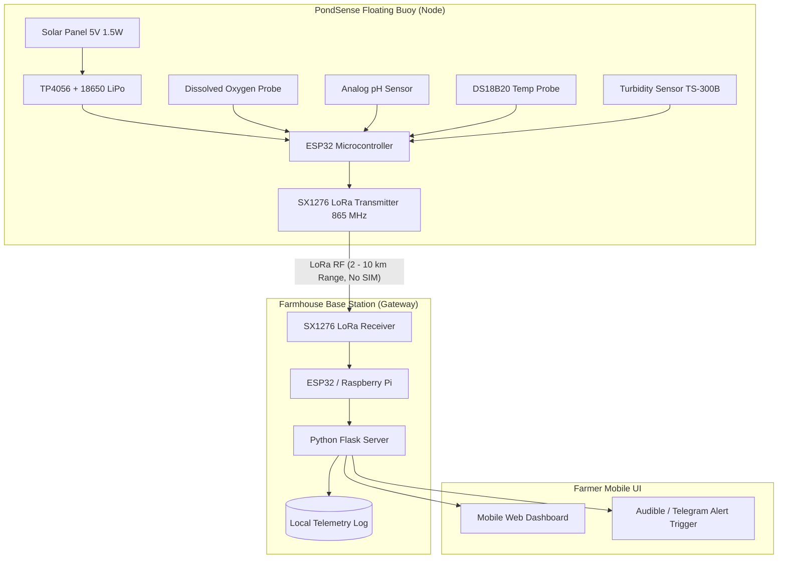
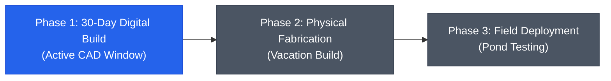

# PondSense

> **An open-source, solar-powered, floating water quality buoy for smallholder aquaculture farmers.**  
> Continuous monitoring of Dissolved Oxygen, pH, Temperature, and Turbidity transmitted over long-range LoRa (865 MHz) with zero cellular subscription fees.

---

## 🌊 The Problem: The Overnight Dissolved Oxygen Crisis

Aquaculture is a **₹50,000 Crore** industry in India, providing livelihoods for millions of rural fish farmers. However, fish mortality caused by poor water conditions—primarily **rapid dissolved oxygen (DO) depletion**, sudden pH swings, and ammonia surges—remains the single largest source of financial disaster.

```
       [ Daytime Photosynthesis ]                 [ Nighttime Respiration & Decay ]
  Sunlight + Phytoplankton = High Oxygen          Algae & Fish Consume Oxygen (No Sun)
                                                                  |
                                                                  v
                                                     [ 2:00 AM – 6:00 AM Hazard Window ]
                                                     DO drops below 3.0 mg/L -> Asphyxiation
                                                     Mass fish death occurs in hours.
```

- **The Status Quo:** Commercial industrial water monitors cost **₹20,000 to ₹80,000+** per pond, pricing out small and medium farmers.
- **The Current Workaround:** Farmers test manually with chemical test strips once during the day, completely missing lethal overnight drops.
- **The Consequence:** A farmer can lose an entire season’s harvest and life savings overnight without warning.

---

## 💡 The Solution: PondSense

**PondSense** is a modular, solar-harvesting floating buoy designed from the ground up to cost **under ₹2,000 (~$25 USD)** to build. It sits autonomously in the middle of a fish pond, samples water parameters 24/7, and transmits real-time telemetry over license-free **LoRa (865–867 MHz ISM band)** to a farmhouse gateway up to 5 km away.

When dissolved oxygen dips below safe thresholds, the system triggers loud audible alarms and mobile dashboard alerts, giving farmers actionable time to turn on aerators before fish begin to die.

<p align="center">
  
</p>

---

## 🛠️ System Architecture



---

## 📊 Sensor Suite

| Parameter | Sensor Module | Why It Matters in Aquaculture | Safe Range |
| :--- | :--- | :--- | :--- |
| **Dissolved Oxygen (DO)** | Galvanic DO Probe / Sensor Circuit | **Primary kill factor.** Fish suffocate rapidly when DO drops below critical levels. | > 4.5 mg/L |
| **pH Level** | Analog pH Electrode Probe | Extreme acidity or alkalinity damages fish gills and accelerates toxic ammonia formation. | 6.5 – 8.5 |
| **Water Temperature** | DS18B20 (Waterproof digital probe) | Dictates fish metabolic rate, feeding efficiency, and maximum oxygen saturation capacity. | 24°C – 32°C |
| **Turbidity (TSS)** | TS-300B Optical Sensor | Measures suspended organic solids; acts as an early indicator of algal blooms or pond siltation. | < 50 NTU |
| **Battery / Solar V** | Voltage Divider to ADC | Monitors energy harvesting state of charge to ensure 24/7 continuous operation. | 3.3V – 4.2V |

---

## 💰 Target Build Cost (< ₹2,000)

By utilizing standard, off-the-shelf maker components sourced from Indian distributors (ROBU.in, Evelta, QuartzComponents), PondSense cuts commercial system costs by **over 90%**:

| Component | Est. Price (INR) | Sourcing / Function |
| :--- | :--- | :--- |
| ESP32 DevKit V1 (30-pin) | ₹380 | Microcontroller with deep sleep & ADC |
| SX1276 LoRa Module (865 MHz) | ₹350 | Long-range radio transmitter |
| DS18B20 Waterproof Temp Probe | ₹95 | Digital water temperature sensor |
| TS-300B Analog Turbidity Sensor | ₹240 | Optical suspended solids sensor |
| Analog pH Sensor & Probe Kit | ₹520 | Water acidity/alkalinity electrode |
| 18650 Li-Ion Cell (2600 mAh) | ₹140 | Nighttime power storage |
| 5V 1.5W Solar Panel + TP4056 | ₹155 | Daylight solar battery harvester |
| Buoy Hardware (O-rings, PG7 glands, M3 SS screws) | ₹80 | Watertight sealing & strain relief |
| 3D Printed Hull (PETG filament ~250g) | ₹150 | Buoyant waterproof enclosure |
| **Total Build Cost** | **~₹2,110** | *Comparable commercial devices cost ₹20,000 – ₹80,000+* |

Detailed sourcing links and part numbers are documented in [docs/bom/bill-of-materials.md](docs/bom/bill-of-materials.md).

---

## 📂 Repository Structure

```text
PondSense/
├── docs/
│   ├── research/          # Research papers, competitive analysis & PDF logs
│   ├── daily-logs/        # Daily committed engineering logs (Day-01.md, Day-02.md, ...)
│   └── bom/               # Bill of materials and supplier links
├── cad/                   # Autodesk Fusion 360 parametric models (.f3d, .step, .stl)
├── firmware/              # Microcontroller C++ code (Arduino / PlatformIO)
│   ├── node/              # Floating buoy sensor sampling & LoRa TX
│   └── gateway/           # Base station receiver & serial/MQTT forwarder
├── backend/               # Python Flask telemetry server & alert engine
├── dashboard/             # Mobile-friendly web dashboard UI
├── tests/                 # Unit tests for firmware algorithms & backend
└── README.md
```

---

## 🗺️ Roadmap



### Phase 1: 30-Day Digital Build *(Current)*
* **Mechanical CAD (Fusion 360):** Complete parametric 3D model of the hydrodynamic buoy hull, ballast chamber, O-ring gasket track, and modular internal electronics sled.
* **Firmware:** ESP32 drivers for DS18B20, pH, Turbidity, and DO sampling, combined with SX1276 LoRa packet transmission and sleep power management.
* **Gateway & Backend:** Gateway receiver code and Python/Flask server with local SQLite logging.
* **Dashboard:** Mobile-responsive real-time monitoring interface with visual threshold indicators.

### Phase 2: Physical Fabrication *(Post-30 Days / Vacation)*
* 3D print the buoy hull in PETG/ABS with 100% infill walls for watertight integrity.
* Benchtop electrical assembly on custom perfboard / milled PCB.
* Hydrostatic immersion and leak testing in water tanks.
* Multi-point sensor calibration using buffer solutions (pH 4.01/6.86/9.18).

### Phase 3: Field Deployment *(Pond Testing)*
* Tethered deployment in an active aquaculture fish pond.
* Long-range RF packet loss stress test across 1–3 km obstructed terrain.
* 72-hour continuous monitoring trial against manual reference tests.

---

## 📖 Daily Engineering Logs
Every step of the design, modeling, and coding journey is documented day by day:
- [Day 1: Project Kickoff, The 30-Day Constraint & Fusion 360 Basics](docs/daily-logs/Day-01.md)
- [Day 2: Ideation, Case Study & The Pivot to PondSense](docs/daily-logs/Day-02.md)
- [Day 3: Mechanical Architecture Blueprint & Conical Hull Design](docs/daily-logs/Day-03.md)
- [Day 4: 3D Conical Hull Complete & ESP32 Firmware Scaffolding](docs/daily-logs/Day-04.md)
- [Day 5: Top Solar Lid Design & DS18B20 Temperature Compensation](docs/daily-logs/Day-05.md)
- [Day 6: Submerged Sensor Shroud Design & Analog pH / Turbidity Drivers](docs/daily-logs/Day-06.md)
- [Day 7: Full Mechanical Buoy Assembly, Section Analysis & LoRa Deep Sleep](docs/daily-logs/Day-07.md)
- [Day 8: Internal Electronics Sled Design & Gateway Firmware Scaffolding](docs/daily-logs/Day-08.md)
- [Day 9: 18650 Battery Cradle Geometry & Python Telemetry Bridge](docs/daily-logs/Day-09.md)
- [Day 10: Flask REST API Server & Farmer Mobile Web Dashboard](docs/daily-logs/Day-10.md)
- *Upcoming logs committed daily.*

---

## 🤝 Contributing & License

Contributions, discussions, and sensor calibration improvements are welcome! Please open an issue or pull request.

Distributed under the **MIT License**. See `LICENSE` for more information.
