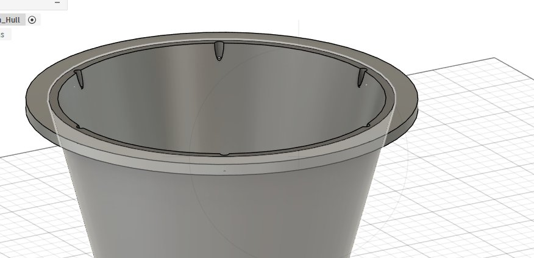
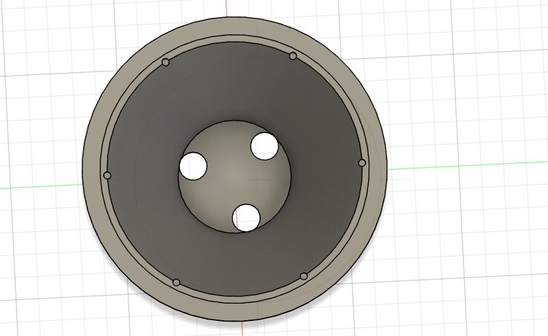

# Day 4: 3D Conical Hull Complete & ESP32 Firmware Scaffolding

- **Date:** 22 November 2026
- **Phase:** Mechanical CAD (Fusion 360) & Embedded Firmware (C++)
- **Focus:** Completing the primary flotation hull (Part 2), cutting bottom cable gland penetrations, and scaffolding the ESP32 sensor telemetry architecture.

---

## 1. Mechanical Engineering Milestone: Part 2 Complete

Today, the core mechanical body of **PondSense**—the **Conical Main Hull**—was completed in Autodesk Fusion 360.

### Finished CAD Model Renders

| Isometric Perspective View | Top-Down Interior View |
| :---: | :---: |
|  |  |
| *Figure 1: Revolved conical hull with reinforced top collar and 3 mm uniform wall.* | *Figure 2: Interior view showing 3x PG7 cable ports and 6x internal sled keyways.* |

### Hull Specifications
* **Height:** `120 mm`
* **Upper Opening:** `Ø 114 mm` inner diameter (`Ø 120 mm` outer wall)
* **Top Flange Collar:** `Ø 136 mm` outer diameter (`8 mm` wide clamping lip)
* **Lower Bulkhead Plate:** `Ø 55 mm` diameter base
* **Wall Thickness:** `3.0 mm` uniform (optimized for watertight 3D printing in PETG)
* **Bottom Sensor Penetrations:** 3× `12.5 mm` through-holes arranged in an equilateral triangle for standard **PG7 nylon cable glands** (accommodating waterproof temp, pH, and turbidity cables)
* **Internal Sled Keyways:** 6× internal alignment notches on the upper rim to lock the internal electronics sled from twisting during water turbulence.

---

## 2. Firmware Architecture Scaffolding

Parallel to mechanical modeling, the core ESP32 firmware was initialized in `firmware/node/`:

* [`config.h`](../../firmware/node/config.h):
  * **Indian 865 MHz ISM Band:** LoRa SX1276 locked to `865.0 MHz`, SF9, 17 dBm TX power.
  * **Hardware SPI Pins:** SCK (GPIO 18), MISO (GPIO 19), MOSI (GPIO 23), NSS (GPIO 5), RST (GPIO 14), DIO0 (GPIO 2).
  * **ADC1 Pin Mapping:** Conflict-free analog pin assignment avoiding ADC2 Wi-Fi conflicts:
    * DS18B20 Digital Temp: **GPIO 4**
    * Analog pH Sensor: **GPIO 34**
    * Turbidity Sensor TS-300B: **GPIO 35**
    * Battery Voltage Divider: **GPIO 36 (VP)**
  * **Packed Telemetry Struct (`BuoyTelemetryPacket`):** Binary structure storing node ID, message sequence, DO, pH, water temperature, turbidity, and battery voltage.
* [`node.ino`](../../firmware/node/node.ino):
  * Initial serial diagnostics, sensor conversion stubs, status LED blink, and sleep loop.

---

## 3. Key CAD Learnings (Fusion 360)
* **The Revolution Axis:** Revolve spins a 2D profile around a 1D centerline. Choosing the vertical center edge creates an upright cone, while choosing the horizontal edge creates a flat disc.
* **Closed Profiles:** Revolve requires a 100% sealed boundary. If any corner has an unclosed gap, Fusion cannot calculate the solid body.
* **The Shell Tool:** Hollowing out a solid body with a single click using `Shell` is vastly cleaner and faster than offsetting complex angled sketch profiles.
* **Parametric Flexibility:** Linking dimensions to user parameters allows immediate adjustments without redrawing downstream features.

---

## 4. Next Steps (Day 5)
* Model **Part 1: The Top Solar Lid** in Fusion 360:
  * Flat circular disc with recessed pocket for the 80x80mm solar panel.
  * Underside O-ring retention groove to mate with the hull flange.
  * LoRa antenna center pass-through port.
* Test-read the **DS18B20 digital temperature probe** over 1-Wire in the firmware.
