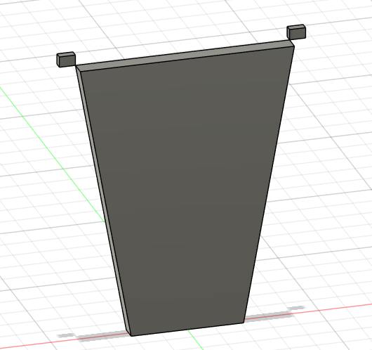

# Day 8: Internal Electronics Sled Design & Gateway Firmware Scaffolding

- **Date:** 26 November 2026
- **Phase:** Mechanical CAD (Fusion 360) & Gateway Firmware (C++)
- **Focus:** Modeling the modular internal electronics sled / chassis (Part 4) and scaffolding the 865 MHz LoRa base station gateway receiver with emergency hypoxia buzzer alerts.

---

## 1. Mechanical Engineering: Part 4 Internal Electronics Sled / Chassis

A floating water quality buoy must never place loose electronics or batteries inside its hull:
1. **Dynamic Wave Action:** Ponds experience wind chop and aerator turbulence. Loose circuit boards or batteries would crash against hull walls, snapping soldered wires.
2. **Center of Gravity Lock:** The heavy 18650 Li-ion cell (~48g) must be rigidly secured at the lowest possible apex of the inverted cone to maintain a low Center of Gravity ($CG$) well below the Center of Buoyancy ($CB$) for self-righting stability.
3. **Modular Serviceability:** A technician or fish farmer must be able to pull the entire electronics stack out of the hull in one motion for battery replacement or bench diagnostics without desoldering probes.

### Sled Dimensions & Specifications
* **Overall Height:** `105.0 mm` (slips cleanly into the `120 mm` conical hull cavity)
* **Top Width:** `80.0 mm` (slides between the upper collar guide rails)
* **Bottom Width:** `42.0 mm` (nests into the narrow bottom cone apex)
* **Spine Plate Thickness:** `3.0 mm` (rigid PETG print)
* **Top Alignment Ears:** 2× locking tabs (`6.0 mm` width × `4.0 mm` height) that engage the 6 internal keyway notches modeled on Day 4.

### CAD Model Visual

  
  
<em>Figure 8.1: Internal Electronics Sled Spine (Part 4) — Tapered structural backbone with dual upper locking ears to prevent internal rotational twist.</em>

### Component Mounting Zones
  * **Lower Apex Zone:** 18650 cell holder mounting bracket (`18.5 mm` cradle radius, `65 mm` length).
  * **Mid Spine Zone:** ESP32-WROOM-32 30-pin DevKit footprint (`52×28 mm`) with zip-tie anchor slots.
  * **Upper Zone:** TP4056 USB-C solar charge controller mount (`28×17 mm`).

---

## 2. Gateway Receiver Firmware Engineering ([`firmware/gateway/`](../../firmware/gateway/))

The **PondSense Base Station Gateway** sits inside the farmer’s house or pump shed, powered 24/7 by a standard 5V USB wall adapter:

1. **Continuous 865.0 MHz LoRa Listening:** Unlike the sleeping buoy node, the gateway stays in continuous RX mode (`SF9`, `BW 125 kHz`, `CR 4/5`) to capture asynchronous packet broadcasts.
2. **Hardware CRC16 Verification:** Validates packet data integrity over the air using CCITT-16 checksums, rejecting corrupted transmissions.
3. **RF Link Quality Metrics:** Logs **RSSI** (Received Signal Strength Indicator in dBm) and **SNR** (Signal-to-Noise Ratio in dB) to monitor link fade margin across the pond.
4. **Emergency Hypoxia Buzzer Alarm:**
   * If Dissolved Oxygen drops below **`< 3.0 mg/L`** (the lethal fish suffocation limit), the gateway immediately triggers an audible piezo buzzer alarm on GPIO 25.
   * Gives the farmer immediate actionable warning at 3:00 AM to switch on pond aerators.
5. **Serial JSON Streaming:** Emits clean, structured JSON telemetry strings over USB Serial (`115200 baud`) to interface with local Python Flask logging servers.

---

## 3. Next Steps (Day 9)
* Model the 18650 battery cradle clips on the sled in Fusion 360.
* Insert the completed Sled into `PondSense_Full_Assembly` and verify internal clearances with Section Analysis.
* Build the Python backend bridge script (`backend/serial_bridge.py`) to parse gateway JSON output into a local SQLite database.
