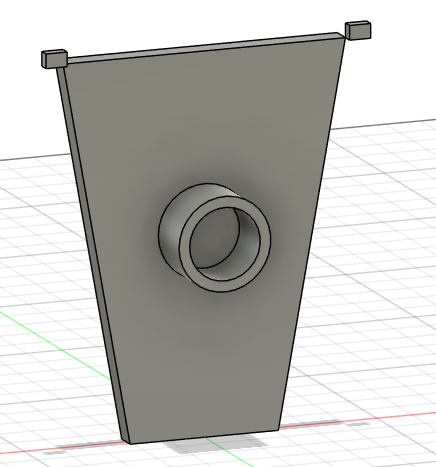

# Day 9: 18650 Battery Cradle Geometry & Python Telemetry Bridge

- **Date:** 27 November 2026
- **Phase:** Mechanical CAD (Fusion 360) & Data Pipeline (Python / SQLite)
- **Focus:** Adding the 18650 cylindrical battery cradle brackets to the internal sled spine (Part 4) and developing the Python serial bridge telemetry pipeline with automated hypoxia alert detection.

---

## 1. Mechanical Engineering: 18650 Battery Cradle Integration

A key tenet of naval architecture in floating water buoys is the **Center of Gravity ($CG$) vs. Center of Buoyancy ($CB$) relationship**:
* The buoy's conical shape provides high displacement volume near the water surface ($CB$ sits near the top collar).
* By mounting the heaviest single internal component—the **18650 Li-ion cell (~48g)**—at the lowest tip of the internal sled, the buoy achieves a strong righting moment:
  $$\overline{GM} = \overline{KB} + \overline{BM} - \overline{KG} > 0$$
  This mathematical condition guarantees positive metacentric stability, ensuring the buoy immediately self-rights even when struck by aerator currents or surface waves.

### Cradle Geometry & Specifications
* **Battery Form Factor:** Standard 18650 cylinder (`18.5 mm` outer diameter with shrink sleeve, `65.0 mm` length).
* **Cradle Profile:** Cylindrical mounting collar (`Ø 20.0 mm` inner diameter, `3.0 mm` wall thickness) projecting `15.0 mm` perpendicularly from the front face of the lower sled spine.
* **Component Clearance:** Leaves `15.0 mm` bottom clearance above the hull's lower cable glands to allow probe signal wires to route cleanly upward to the ESP32.

### CAD Model Visual

<div align="center">
  
  <p><em>Figure 9.1: Internal Electronics Sled with lower component collar and upper anti-rotation alignment tabs.</em></p>
</div>

---

## 2. Software Architecture: Gateway Serial Bridge & SQLite Pipeline

The software pipeline converts raw radio transmissions captured by the Farmhouse Gateway into structured, queryable data:

```
[ ESP32 Buoy Node ] 
       │  (LoRa 865 MHz)
       ▼
[ Base Station Gateway ] 
       │  (USB Serial @ 115200 baud)
       ▼
[ Python Serial Bridge (serial_bridge.py) ]
       ├── JSON Telemetry Validation
       ├── Automated Safety Threshold Rules Engine
       │     ├── DO < 3.0 mg/L  ➔  CRITICAL HYPOXIA ALERTS
       │     └── pH < 6.5 / > 8.5  ➔  WATER QUALITY WARNINGS
       ▼
[ SQLite Database (pondsense.db) ]
       ├── telemetry (Historical Sensor Records)
       └── alerts (Unacknowledged Farm Emergency Alarms)
```

### Key Python Deliverables:
1. **[`backend/database.py`](../../backend/database.py):**
   * Manages SQLite connection pooling, schema initialization, indexed queries, and alert logging.
2. **[`backend/serial_bridge.py`](../../backend/serial_bridge.py):**
   * USB serial listener with error handling and automatic packet recovery.
   * Built-in **Telemetry Simulation Mode (`--simulate`)**: Generates realistic 24-hour diurnal pond data curves for benchtop software testing without requiring connected microcontroller hardware.
3. **[`backend/requirements.txt`](../../backend/requirements.txt):**
   * Dependencies for serial communication and web API serving (`pyserial`, `Flask`, `flask-cors`).

---

## 3. Next Steps (Day 10)
* Test-fit the complete Sled assembly inside `PondSense_Full_Assembly` and verify 3D component clearances.
* Build the **REST API Server (`backend/app.py`)** with Flask to expose `/api/telemetry/latest`, `/api/telemetry/history`, and `/api/alerts` for the mobile dashboard.
